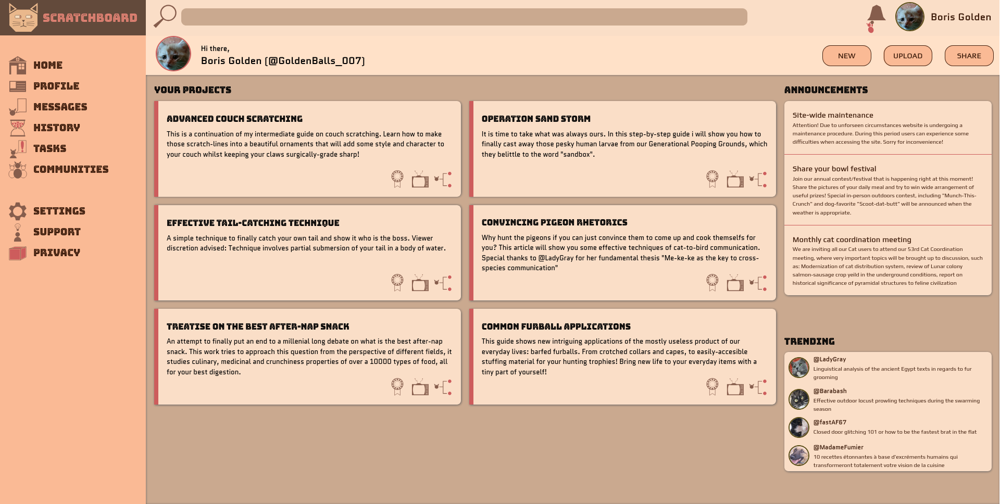

# Catmin-ScratchBoard

A handy control center, so one can monitor, organize and share all projects they have started scratching their paws on

## Preview

## Description

This project's main goal is to show HTML Grid layout functionality. It means to demonstrate ease of layout creation and, no pun intended, flexibility when using Grid in combination with Flexbox.

Additionally project is used to showcase various advanced HTML features such as:
- HTML forms
- Animated SVG usage
- Dynamic element positioning

## Credits

Fonts:
- Bungee Inline: https://fonts.google.com/specimen/Bungee+Inline
- Quantico: https://fonts.google.com/specimen/Quantico
- Play: https://fonts.google.com/specimen/Play

Images:
- All images used in the project are from mine personal collection

Icons: 
- Cat-Icons: https://github.com/VortexRiker/cat-icons

Logo:
- Cat-Logo: https://github.com/VortexRiker/cat-logo
